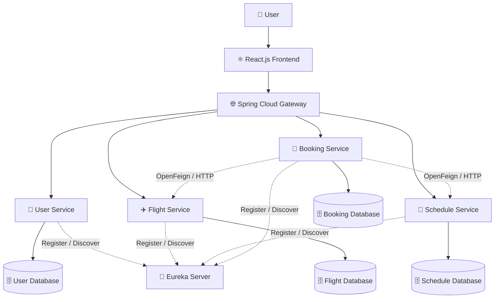
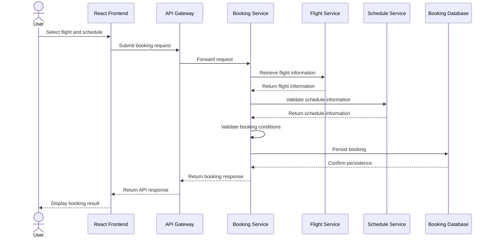

<div align="center">

# ✈️ Flight Service Platform

### A Microservices-Based Flight Reservation System

**Designed with Java 17, Spring Boot, Spring Cloud, React.js & MySQL**

A full-stack flight management and reservation platform built using a distributed microservices architecture, independent services, centralized API routing, and service discovery.

<br/>

[](https://www.oracle.com/java/)
[](https://spring.io/projects/spring-boot)
[](https://spring.io/projects/spring-cloud)
[](https://react.dev/)
[](https://www.mysql.com/)

<br/>

[🚀 Explore Repository](https://github.com/sumit-git204/FlightServicePlatform_microservices)
  •  
[🐛 Report an Issue](https://github.com/sumit-git204/FlightServicePlatform_microservices/issues)
  •  
[💡 Request a Feature](https://github.com/sumit-git204/FlightServicePlatform_microservices/issues)

</div>

---

## 📑 Table of Contents

* [🌟 Overview](#-overview)
* [💡 Why This Project?](#-why-this-project)
* [✨ Key Features](#-key-features)
* [🏗️ System Architecture](#️-system-architecture)
* [🧩 Microservices Breakdown](#-microservices-breakdown)
* [⚙️ How It Works](#️-how-it-works)
* [🛠️ Technology Stack](#️-technology-stack)
* [🗂️ Project Structure](#️-project-structure)
* [🚀 Getting Started](#-getting-started)
* [🔌 API Documentation](#-api-documentation)
* [🔐 Security and Data Management](#-security-and-data-management)
* [🧠 Engineering Highlights](#-engineering-highlights)
* [🔮 Future Enhancements](#-future-enhancements)
* [👨‍💻 Author](#-author)

---

## 🌟 Overview

**Flight Service Platform** is a full-stack flight reservation application designed around a microservices architecture.

Instead of building the entire backend as one large application, the system separates its responsibilities into four independent services:

* 👤 User Service
* ✈️ Flight Service
* 📅 Schedule Service
* 🎫 Booking Service

The services communicate through well-defined APIs, while **Spring Cloud Gateway** provides a centralized entry point and **Netflix Eureka** enables service discovery.

The React.js frontend provides the user interface, while MySQL databases support persistent data storage.

### 🎯 Project Objective

To design and implement a modular, maintainable flight management system that demonstrates how independent backend services can work together to support flight search, scheduling, user management, and reservation workflows.

---

## 💡 Why This Project?

Traditional monolithic applications combine multiple responsibilities into one application. As a system grows, this can make individual components harder to maintain and evolve independently.

This project explores a different approach.

| Traditional Monolithic Approach                           | This Project                                                                      |
| --------------------------------------------------------- | --------------------------------------------------------------------------------- |
| Multiple responsibilities in one application              | Responsibilities separated into microservices                                     |
| Centralized application logic                             | Independent service-level business logic                                          |
| Tightly coupled internal modules may complicate changes   | API-based communication between services                                          |
| Scaling individual business capabilities can be difficult | Services can be evolved and deployed independently, subject to their dependencies |
| Internal routing within one application                   | Centralized routing through Spring Cloud Gateway                                  |

**The goal isn't simply to build a flight booking interface. It's to understand and implement the backend architecture that supports a distributed application.**

---

## ✨ Key Features

<table>
  <tr>
    <td width="50%">
      <h3>✈️ Flight Management</h3>
      Manage flight information and support flight search operations.
    </td>
    <td width="50%">
      <h3>📅 Schedule Management</h3>
      Organize flight schedules and their associated information.
    </td>
  </tr>
  <tr>
    <td width="50%">
      <h3>👤 User Management</h3>
      Separate user-related operations into a dedicated service.
    </td>
    <td width="50%">
      <h3>🎫 Booking Management</h3>
      Handle flight reservations and booking-related operations.
    </td>
  </tr>
  <tr>
    <td width="50%">
      <h3>❌ Booking Cancellation</h3>
      Support cancellation workflows, including seat restoration where applicable.
    </td>
    <td width="50%">
      <h3>🌐 Centralized API Gateway</h3>
      Route client requests to the appropriate backend services.
    </td>
  </tr>
  <tr>
    <td width="50%">
      <h3>🔎 Service Discovery</h3>
      Use Eureka for service registration and discovery.
    </td>
    <td width="50%">
      <h3>🔗 Inter-Service Communication</h3>
      Use OpenFeign for declarative HTTP communication between services.
    </td>
  </tr>
</table>

---

## 🏗️ System Architecture

The platform follows a microservices architecture with separate services for users, flights, schedules, and bookings.

The following diagram illustrates the high-level design.



### 🔍 Understanding the Architecture

| Component                | Responsibility                                               |
| ------------------------ | ------------------------------------------------------------ |
| **React.js**             | Provides the user-facing application interface.              |
| **Spring Cloud Gateway** | Acts as the centralized entry point for client API requests. |
| **Eureka Server**        | Maintains service registration and discovery information.    |
| **User Service**         | Handles user-related operations.                             |
| **Flight Service**       | Manages flight information.                                  |
| **Schedule Service**     | Handles flight scheduling information.                       |
| **Booking Service**      | Coordinates reservation-related operations.                  |
| **OpenFeign**            | Simplifies HTTP communication between services.              |
| **MySQL**                | Provides persistent storage for service-specific data.       |

*Architecture note: The diagram is a high-level representation of the intended design. Actual service routes, communication dependencies, and database ownership should match the implementation in the repository.*

---

## 🧩 Microservices Breakdown

### 1. 👤 User Service

Responsible for user-related business operations.

**Responsibilities:**

* Manage user information.
* Provide user-related REST APIs.
* Maintain user data independently of other services.

### 2. ✈️ Flight Service

Responsible for flight information and flight management.

**Responsibilities:**

* Maintain flight-related information.
* Support flight search and retrieval.
* Provide flight data to other services through APIs.

### 3. 📅 Schedule Service

Responsible for flight scheduling information.

**Responsibilities:**

* Manage flight schedule data.
* Support schedule-related operations.
* Make scheduling information available to dependent services.

### 4. 🎫 Booking Service

Responsible for reservation-related business logic.

**Responsibilities:**

* Handle booking operations.
* Coordinate with relevant services to retrieve required flight and schedule information.
* Support cancellation workflows.
* Handle booking-related fare and seat-management logic where implemented.

### 💎 Why Separate These Services?

Each service has a defined business responsibility. This separation helps organize the codebase, establish clearer service boundaries, and reduce the need to place all business logic in a single backend application.

---

## ⚙️ How It Works

### 🔄 Flight Booking Workflow

The following sequence illustrates a typical booking workflow.



*This sequence is illustrative. It should be adjusted to reflect the exact request flow, validation logic, and persistence order implemented in the code.*

### ❌ Booking Cancellation Workflow

A cancellation workflow may involve:

1. Receiving the cancellation request.
2. Identifying and validating the booking.
3. Updating the booking status.
4. Restoring seat availability when required.
5. Returning the cancellation result.

Correct implementation requires consistent updates across the relevant services. If booking and seat information reside in different services, distributed consistency must also be considered.

---

## 🛠️ Technology Stack

### Backend

| Technology                  | Purpose                                            |
| --------------------------- | -------------------------------------------------- |
| Java 17                     | Core programming language                          |
| Spring Boot                 | Backend application development                    |
| Spring Cloud                | Microservices infrastructure                       |
| Spring Cloud Gateway        | Centralized API routing                            |
| Netflix Eureka              | Service discovery                                  |
| OpenFeign                   | Inter-service HTTP communication                   |
| Spring Data JPA / Hibernate | Persistence and ORM, where configured              |
| Spring Security             | Authentication and authorization, where configured |
| MySQL                       | Relational database                                |

### Frontend

| Technology | Purpose                        |
| ---------- | ------------------------------ |
| React.js   | Component-based user interface |
| JavaScript | Frontend application logic     |
| HTML5      | Application structure          |
| CSS3       | Styling and layout             |

---

## 🗂️ Project Structure

The repository contains separate backend and frontend directories.

```text
FlightServicePlatform_microservices/
│
├── FlightServicePlatform__Backend/
│   ├── User Service
│   ├── Flight Service
│   ├── Schedule Service
│   ├── Booking Service
│   ├── API Gateway
│   └── Eureka Server
│
├── FlightService_Frontend/
│   ├── public/
│   ├── src/
│   ├── package.json
│   └── ...
│
└── README.md
```

*The backend tree is conceptual; retain the actual service folder names and nesting from your repository.*

---

## 🚀 Getting Started

Follow these steps to prepare the project for local development.

### 📋 Prerequisites

Install the tools required by your project:

* Java Development Kit (JDK) 17
* Maven, if the backend uses Maven
* Node.js and npm
* MySQL
* Git

### 1. Clone the Repository

```bash
git clone https://github.com/sumit-git204/FlightServicePlatform_microservices.git
```

Navigate into the repository:

```bash
cd FlightServicePlatform_microservices
```

### 2. Configure the Backend

Navigate to the backend directory:

```bash
cd FlightServicePlatform__Backend
```

Configure the MySQL connection settings for each applicable service.

Typical configuration values include:

```properties
spring.datasource.url=jdbc:mysql://localhost:3306/your_database
spring.datasource.username=${DB_USERNAME}
spring.datasource.password=${DB_PASSWORD}
```

These are illustrative properties. Use the actual configuration keys expected by each service.

Set the necessary environment variables or configure local development properties before starting the applications.

### 3. Start the Backend Services

Start the Eureka Server first if your services depend on it for registration and discovery.

Then start the required backend services, including the API Gateway and the User, Flight, Schedule, and Booking services.

For Maven-based applications, a typical command is:

```bash
mvn spring-boot:run
```

Run this command from the directory containing the relevant service's `pom.xml`.

**Important:** Start each service using its actual project directory and configuration. The required ports and startup order depend on your implementation.

### 4. Configure the Frontend

Open a separate terminal and navigate to the frontend directory:

```bash
cd FlightService_Frontend
```

Install the dependencies:

```bash
npm install
```

Start the frontend using the script defined in `package.json`.

For a Vite application:

```bash
npm run dev
```

For a Create React App application:

```bash
npm start
```

Open the local URL displayed in your terminal.

### 5. Verify the Application

Confirm that:

* The frontend starts successfully.
* The backend services connect to their configured databases.
* Services register with Eureka where configured.
* Gateway routes reach the appropriate services.
* Booking and cancellation APIs behave as expected.

---

## 🔌 API Documentation

The backend exposes REST APIs for the platform's business operations.

If a service uses Springdoc OpenAPI, its interactive API documentation may be available at:

```text
http://localhost:<service-port>/swagger-ui/index.html
```

The corresponding OpenAPI specification may be available at:

```text
http://localhost:<service-port>/v3/api-docs
```

Replace `<service-port>` with the configured port for the relevant service.

The actual documentation URLs depend on whether Springdoc OpenAPI is installed and configured. If the project does not include it, add and configure the appropriate dependency before using these endpoints.

---

## 🔐 Security and Data Management

The architecture separates business responsibilities and database ownership across services.

Key considerations include:

* Keep database credentials and secret keys outside committed source files.
* Configure appropriate access controls for protected endpoints.
* Validate incoming API requests.
* Avoid exposing internal service endpoints unnecessarily.
* Configure CORS appropriately for the frontend's origin.
* Handle errors and service failures explicitly.

Spring Security and role-based access controls should be documented as implemented only where the relevant configuration and authorization rules exist in the codebase.

---

## 🧠 Engineering Highlights

The most important aspect of this project is the backend architecture.

### 🏗️ 1. Microservices Design

Separated user, flight, schedule, and booking responsibilities into distinct services.

### 🌐 2. Centralized API Routing

Integrated Spring Cloud Gateway to provide a common entry point for frontend requests.

### 🔎 3. Service Discovery

Used Eureka to support service registration and discovery.

### 🔗 4. Inter-Service Communication

Used OpenFeign to simplify communication between backend services through HTTP APIs.

### 🗄️ 5. Database-per-Service Architecture

Organized persistence around individual service boundaries instead of treating the entire backend as one shared database-backed application.

### 🔄 6. Reservation Business Logic

Implemented or designed booking and cancellation operations involving flight and schedule validation, fare calculation, and seat availability management.

---

## 🔮 Future Enhancements

Potential extensions for the platform include:

* 💳 Payment gateway integration.
* 📧 Email notifications for booking confirmations and cancellations.
* 🔐 Token-based authentication and authorization.
* 🐳 Docker-based deployment.
* ☁️ Cloud deployment and automated CI/CD pipelines.
* 📊 Centralized logging and monitoring.
* 🔁 Resilience patterns for inter-service communication.
* 🧪 Automated unit, integration, and end-to-end testing.
* ⚡ Caching for frequently accessed flight information.

These are potential enhancements, not claims about functionality already implemented.

---

## 👨‍💻 Author

<div align="center">

### Sumit Badoni

Software Development Engineer Aspirant | Java | Spring Boot | Microservices | React.js

Building full-stack applications and exploring scalable backend architectures.

<br/>

[](https://github.com/sumit-git204)

[](https://github.com/sumit-git204/FlightServicePlatform_microservices)

</div>

---

<div align="center">

### ⭐ Found this project interesting?

Explore the repository, review the architecture, and share suggestions for improvement.

**Built with Java, Spring Boot, Spring Cloud, React.js, and MySQL.**

</div>
